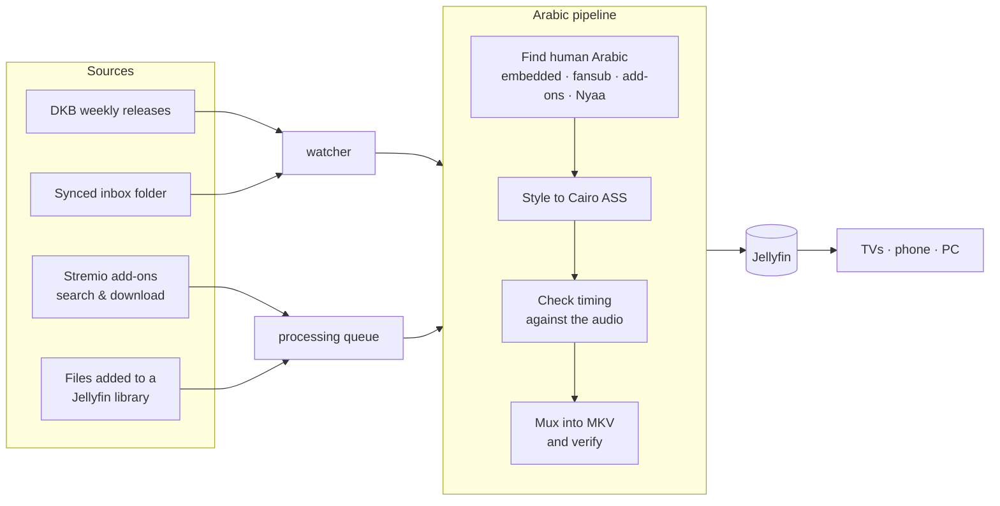

<div align="center">


# Kizuna

**Your anime and movies, with beautiful Arabic subtitles. Automatically.**

Kizuna (絆, *"bond"*) watches for new episodes, finds real human Arabic subtitles, styles them, checks the timing
against the episode's own audio, and delivers a ready-to-watch file to Jellyfin, without you lifting a finger.

[](https://www.python.org/)
[](#requirements)
[](https://jellyfin.org/)
[](https://www.stremio.com/)
[](#tests)

[Highlights](#highlights) · [How it works](#how-it-works) · [Getting started](#getting-started) ·
[Reliability](#reliability--safety) · [Tests](#tests) · [Operations guide](docs/OPERATIONS.md)

</div>

---

## Highlights

| | |
|---|---|
| 🎬 **Hands-off weekly anime** | New episodes are fetched (DKB 1080p) or picked up from a synced folder, subtitled, and in Jellyfin soon after release. |
| ✍️ **Human Arabic only** | Official Arabic tracks, fan translations (chosen per show by policy) and Stremio subtitle add-ons. Never machine translation. |
| 🎨 **House style** | Cairo font, right-to-left marks, clean speaker dashes, translator credits and site adverts removed, fonts embedded. |
| ⏱️ **Timing you can trust** | Every subtitle is matched against the episode's real audio; a consistent offset is corrected, an inconsistent one is held for review. |
| 🔍 **Find & download** | Search movies, series and anime across your Stremio add-ons, check the real tracks, then download one episode, a season or a whole show. |
| 🗣️ **Dub aware** | Arabic-dubbed files skip subtitle work; Arabic burned into the picture is detected with Windows OCR and left alone. |
| 📺 **Live dashboard** | A local app window with progress, queue, air-time schedule (AniList), "needs a look" items and the log. |
| 🧹 **Tidy library** | Watched episodes go to the Recycle Bin 24 h after Jellyfin marks them played. Movies are never touched. |

## How it works



1. **Arrive.** A new episode lands: downloaded from DKB, synced to the inbox, picked in the Stremio page, or dropped into a library.
2. **Find Arabic.** The file's own Arabic track first; otherwise a fan or official translation chosen by the show's policy from your Stremio subtitle add-ons, or the Arabic track of a multi-sub release on Nyaa.
3. **Style.** [`srt2ass.py`](srt2ass.py) converts it to the Cairo house style and strips credits and adverts.
4. **Time.** [`audio_fit.py`](audio_fit.py) lines the cues up with speech in the audio; when the audio is unsure, the file's own English track gives a second opinion.
5. **Mux & verify.** [`mux.py`](mux.py) adds Arabic as the default subtitle in a temporary copy, re-extracts it, and only then replaces the original.
6. **Deliver.** The finished file goes into the right Jellyfin library and folder, and a Windows notification says it's ready.

## Getting started

### Requirements

- Windows 10 or 11
- Python 3.13 with the packages in [`requirements.txt`](requirements.txt)
- [FFmpeg](https://ffmpeg.org/) (`ffmpeg` and `ffprobe` on `PATH`) and [MKVToolNix](https://mkvtoolnix.download/)
- A [Jellyfin](https://jellyfin.org/) server
- Optional: [Stremio](https://www.stremio.com/) with Stremio Service, for search, downloads and subtitle add-ons
- Optional: Node.js, only for the page tests

### Install

```powershell
git clone https://github.com/mw4z/Kizuna.git
cd Kizuna
py -3.13 -m pip install -r requirements.txt
```

### Run

```powershell
# the watcher: folder watch, DKB checks, library queue, dashboard and cleanup
pythonw watcher.py

# the dashboard as an app window (Start menu + Desktop shortcuts)
powershell -File make_shortcuts.ps1     # then open "MyAnimeWatcher", or http://localhost:8097
```

To start with Windows, add a Task Scheduler task that runs `pythonw.exe watcher.py` at logon with this folder as the
working directory. The watcher supervises itself and restarts its worker within seconds if it ever stops.

### Configure

Everything everyday is on the pages, no code edits needed:

| What | Where |
|---|---|
| Follow, edit or stop following weekly shows (sources, numbering, subtitle rule, start episode) | **Weekly** page (`/weekly`) |
| Audio languages and resolutions for weekly episodes, check interval, air-time clock, cleanup delay, notifications, default libraries | **Settings** page (`/settings`) |
| Subtitle policy for shows outside the weekly list (e.g. a back catalogue) | [`subtitle_policy.json`](subtitle_policy.json) |
| Stremio account (stored encrypted for your Windows user) | `python stremio_account.py --import-local` |

Your show list (`shows.json`) and settings (`settings.json`) stay on your PC; both are git-ignored.

The inbox folder and library paths are constants: `FOLDER` and `LIBRARY` in [`agent.py`](agent.py), `ANIME` in
[`cleanup.py`](cleanup.py).
Every behaviour, path and edge case is described in the **[operations guide](docs/OPERATIONS.md)**.

## Reliability & safety

Kizuna runs unattended on a home PC, so it's built to fail safe:

- **Originals are never at risk.** Muxing happens in a temporary copy that must pass track, duration and dialogue
  checks before it replaces anything; manual library imports keep a byte-exact backup.
- **Crash and restart safe.** Shared state is written atomically, with retries for Windows file locks; interrupted
  downloads, deliveries and jobs are recovered or cleaned up on the next start.
- **Bounded retries.** Missing subtitles are retried with back-off (up to once a day), and a file that keeps failing
  never blocks the queue.
- **Full control of downloads.** Pause, resume and cancel work in every phase, for single downloads and season
  batches; paused time never counts against the time limit.
- **Locked-down network.** Every media connection goes through a local filtering proxy that only reaches public
  addresses, re-checks redirects and HLS segments, and blocks DNS rebinding. The dashboard only answers on
  `localhost`, and secrets never appear in logs.

## Tests

```powershell
python -m unittest test_agent test_audit test_audit_fixes test_dkb test_fansub test_fillers `
    test_mandatory_processing test_robust test_stremio test_stremio_batch test_reliability test_shows test_settings
node test_picker.cjs
```

**256 tests**, all in temporary folders: real ffmpeg, ffprobe and MKVToolNix runs on tiny generated videos, Windows
file locks under concurrent polling, simulated crashes and restarts, a slow server through the proxy, and the proxy's
SSRF rules. They never touch real media. [`AGENTS.md`](AGENTS.md) has the rules for developing safely on a live system.

## Project layout

| File | Role |
|---|---|
| [`watcher.py`](watcher.py) | Supervisor and folder watcher; hosts the dashboard, DKB checks, library queue and cleanup |
| [`agent.py`](agent.py) | The Arabic pipeline: find, style, time, mux, verify, deliver |
| [`library_processing.py`](library_processing.py) · [`processing_worker.py`](processing_worker.py) | Durable queue for Stremio downloads and library imports, each prepared in an isolated worker |
| [`fansub.py`](fansub.py) | Ranks Arabic subtitles from Stremio add-ons by show policy and timing |
| [`srt2ass.py`](srt2ass.py) · [`audio_fit.py`](audio_fit.py) · [`mux.py`](mux.py) | Styling, audio timing check, verified MKV mux |
| [`hardsub.py`](hardsub.py) | Detects Arabic burned into the picture (Windows OCR) |
| [`stremio.py`](stremio.py) · [`stremio_batch.py`](stremio_batch.py) · [`stremio.html`](stremio.html) | Search, track checks, downloads and season batches |
| [`egress.py`](egress.py) | Filtering proxy for every outgoing media connection |
| [`status.py`](status.py) | Local app server at `http://localhost:8097` (pages, API, live status) |
| [`dashboard.html`](dashboard.html) · [`weekly.html`](weekly.html) · [`settings.html`](settings.html) | The Now, Weekly and Settings pages |
| [`kizuna.css`](kizuna.css) · [`kizuna.js`](kizuna.js) | Shared design system and app shell (navigation, live activity, artwork fallbacks) |
| [`shows.py`](shows.py) | Followed weekly shows: AniList recommendations, DKB/Stremio linking, the Stremio source for new episodes |
| [`settings.py`](settings.py) | Validated personal preferences |
| [`dkb.py`](dkb.py) · [`torrent.py`](torrent.py) · [`fillers.py`](fillers.py) | Weekly releases, torrent helper, filler guide |
| [`cleanup.py`](cleanup.py) | Recycles watched episodes |
| [`docs/OPERATIONS.md`](docs/OPERATIONS.md) | Full operations guide |

---

<div align="center">
<sub>Made for a home where anime is watched in Arabic. Subtitles belong to their translators; Kizuna only finds, styles and times them.</sub>
</div>
