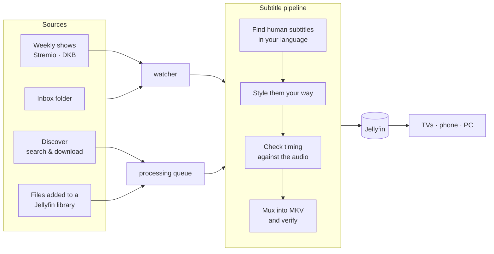

<div align="center">


# Kizuna

**Your anime and movies, with beautiful subtitles in your language. Automatically.**

Kizuna (絆, *"bond"*) watches for new episodes, finds real human subtitles in your language, styles them the way
you like, checks the timing against the episode's own audio, and delivers a ready-to-watch file to Jellyfin,
without you lifting a finger.

[](#requirements)
[](https://www.python.org/)
[](https://jellyfin.org/)
[](https://www.stremio.com/)
[](#tests)

[Highlights](#highlights) · [Install](#install) · [First-run setup](#first-run-setup) · [How it works](#how-it-works) ·
[Privacy](#your-data-stays-yours) · [Tests](#tests) · [Operations guide](docs/OPERATIONS.md)

</div>

---

## Highlights

| | |
|---|---|
| 🌍 **Your language** | Arabic, English, Spanish, Portuguese, French, German, Italian, Russian, Turkish, Polish, Dutch, Indonesian, Persian or Hebrew. Right-to-left languages handled properly. |
| 🎬 **Hands-off weekly anime** | Follow shows on the Weekly page; each new episode is fetched as soon as it is out, subtitled and in Jellyfin. |
| ✍️ **Human subtitles only** | Official tracks, fan translations (chosen per show) and your Stremio subtitle add-ons. Machine translations are rejected, and every file is checked to really be in your language. |
| 🎨 **Your style** | Pick the font (14 bundled, embedded in every file so every TV shows it), size, colours, outline, shadow and background box, with a live preview drawn by the real subtitle renderer. |
| ⏱️ **Timing you can trust** | Every subtitle is matched against the episode's audio; a consistent offset is corrected, an inconsistent one is held for review. |
| 🔍 **Find & download** | Search movies, series and anime across your Stremio add-ons, check a release's real tracks, then send one episode, a season or a whole show. |
| 🗣️ **Dub aware** | Files dubbed in your language skip subtitle work; subtitles burned into the picture are detected and left alone. |
| 📺 **A real app** | Now, Discover, Weekly, News and Settings pages with progress, schedule, filler marks and news. The interface itself is English or Arabic. |
| 🧹 **Tidy library** | Watched episodes go to the Recycle Bin a day after Jellyfin marks them played (you choose the delay). Movies are never touched. |

## Install

### Requirements

- Windows 10 or 11 (64-bit)
- About 1 GB free for the apps, plus room for your library
- A Stremio account (free) with your add-ons, and Jellyfin (the installer can set it up)

### With the installer (recommended)

1. Download **`Kizuna-Setup.exe`** from the [latest release](https://github.com/mw4z/Kizuna/releases/latest).
2. Run it. No administrator rights are needed. Keep the boxes for **FFmpeg** and **MKVToolNix** ticked, and tick
   **Jellyfin** if you don't have it yet. Each one installs in its own window through Windows' installer (winget);
   follow and approve it there.
3. When it finishes, Kizuna opens its **setup wizard**. It also starts by itself when you sign in to Windows.

Windows SmartScreen may warn about a new, unsigned app: choose *More info → Run anyway*.

### From source (developers)

```powershell
git clone https://github.com/mw4z/Kizuna.git
cd Kizuna
py -3.13 -m pip install -r requirements.txt
winget install Gyan.FFmpeg MoritzBunkus.MKVToolNix     # tools Kizuna runs
pythonw watcher.py                                      # starts Kizuna; then open http://localhost:8097
powershell -File make_shortcuts.ps1                     # optional: Start menu and Desktop shortcuts
```

To build the installer yourself: `python -m PyInstaller installer/kizuna.spec`, then `iscc installer\kizuna.iss`
(Inno Setup). The [release workflow](.github/workflows/release.yml) does both on GitHub for every version tag.

## First-run setup

The first time you open Kizuna, the wizard walks you through everything, checking each step as you go. You can
run it again any time from **Settings → Run setup again**.

1. **Languages.** The interface language (English or Arabic) and the **subtitle language** Kizuna adds.
2. **Apps.** Checks FFmpeg and MKVToolNix and offers to install anything missing.
3. **Folders.** Three folders on a drive with space: the **Inbox** (new episodes arrive here), the **Weekly
   library** (followed shows) and the **Anime library** (finished shows). Kizuna creates them for you.
4. **Jellyfin.**
   1. Install Jellyfin Server and open `http://localhost:8096`. Finish Jellyfin's own welcome: create your user
      and pick your metadata language.
   2. *Dashboard → Libraries → Add Media Library*: type **Shows**, name **Weekly Anime**, folder = your Weekly
      library. The wizard shows the path with a Copy button.
   3. Add a second **Shows** library named **Anime** with the Anime library folder, and a **Movies** library if
      you'll send films from Discover.
   4. If Jellyfin runs as a Windows service and the libraries stay empty, give it read access to those folders
      (folder → *Properties → Security → Edit*, add **NETWORK SERVICE** with *Read*).

   The wizard confirms when Jellyfin is running and a library points at each folder.
5. **Stremio.**
   1. In the Stremio app or at [web.stremio.com](https://web.stremio.com), open **Add-ons** and install at least one
      add-on that provides streams you are allowed to use, plus a subtitle add-on such as **OpenSubtitles**.
   2. Sign in to Stremio in the wizard. Your password goes only to Stremio's sign-in; Kizuna keeps the session
      key, encrypted for your Windows user.
   3. The wizard confirms a stream add-on and a subtitle add-on. Added more later? *Discover → Sync Stremio add-ons*.
6. **Ready.** Follow a few shows on the **Weekly** page, or send anything from **Discover**.

Everything else is on the pages; nothing needs code edits:

| What | Where |
|---|---|
| Follow shows, their sources (Stremio and DKB), numbering and subtitle rule | **Weekly** |
| Subtitle language and style, folders, audio languages and resolutions (anime and movies & series separately), check interval, clock, cleanup delay, notifications, interface language | **Settings** |
| Rules for shows outside the weekly list (e.g. a back catalogue) | `subtitle_policy.json` (copy [`subtitle_policy.example.json`](subtitle_policy.example.json)) |

## How it works



1. **Arrive.** A new episode lands: fetched for a followed show, synced to the inbox, sent from Discover, or dropped into a library.
2. **Find.** The file's own track in your language first; otherwise a fan or official translation from your Stremio subtitle add-ons, chosen by the show's rule, or the track of a multi-language release. Each candidate is checked to be real dialogue in your language.
3. **Style.** [`srt2ass.py`](srt2ass.py) applies your style and strips translator credits and site adverts.
4. **Time.** [`audio_fit.py`](audio_fit.py) lines the cues up with speech in the audio; when unsure, the file's other subtitle track gives a second opinion.
5. **Mux & verify.** [`mux.py`](mux.py) adds the track as the default subtitle in a temporary copy, re-extracts it, and only then replaces the original.
6. **Deliver.** The file goes into the right Jellyfin library, and a notification says it's ready.

## Your data stays yours

Your settings, followed shows, Stremio session, history and logs live only on your PC, in files that are never part
of the repository (`settings.json`, `shows.json`, `stremio-account.bin`, `state.json`, …). The Stremio session is
encrypted for your Windows user. The pages only answer on `localhost`, and every media connection goes through a
filtering proxy that only reaches public addresses.

## Reliability & safety

- **Originals are never at risk.** Muxing happens in a temporary copy that must pass track, duration and dialogue checks before it replaces anything; library imports keep a byte-exact backup.
- **Crash and restart safe.** Shared state is written atomically with retries for Windows file locks; interrupted downloads, deliveries and jobs are recovered on the next start.
- **Bounded retries.** Missing subtitles are retried with back-off, and a file that keeps failing never blocks the queue.
- **Full control of downloads.** Pause, resume and cancel in every phase, for single downloads and season batches.

## Tests

```powershell
python -m unittest test_agent test_audit test_audit_fixes test_dkb test_fansub test_fillers test_mandatory_processing `
    test_robust test_stremio test_stremio_batch test_reliability test_shows test_settings test_news test_subtitle_style `
    test_language test_setup
node test_picker.cjs
node test_i18n.cjs        # every page string and message has an Arabic translation
```

**319 tests**, all in temporary folders: real ffmpeg, ffprobe and MKVToolNix runs on tiny generated videos (in Arabic
and English), Windows file locks, simulated crashes and restarts, the network proxy's rules, and the language checks
for every supported language. They never touch real media. [`AGENTS.md`](AGENTS.md) has the rules for developing on
a live system.

## Project layout

| File | Role |
|---|---|
| [`kizuna_app.py`](kizuna_app.py) · [`installer/`](installer) | Entry point of `Kizuna.exe`; PyInstaller recipe and Inno Setup installer |
| [`watcher.py`](watcher.py) | Supervisor and folder watcher; hosts the pages, weekly checks, library queue and cleanup |
| [`agent.py`](agent.py) | The subtitle pipeline: find, style, time, mux, verify, deliver |
| [`language.py`](language.py) | The 14 subtitle languages: codes, text checks, credits, right-to-left, default fonts |
| [`library_processing.py`](library_processing.py) · [`processing_worker.py`](processing_worker.py) | Durable queue for downloads and library imports, each prepared in an isolated worker |
| [`fansub.py`](fansub.py) | Ranks subtitles from Stremio add-ons by show rule, language check and timing |
| [`srt2ass.py`](srt2ass.py) · [`subtitle_style.py`](subtitle_style.py) · [`audio_fit.py`](audio_fit.py) · [`mux.py`](mux.py) | Styling, the style editor and preview, audio timing, verified MKV mux |
| [`hardsub.py`](hardsub.py) | Detects subtitles burned into the picture (Windows OCR) |
| [`setup.py`](setup.py) · [`setup.html`](setup.html) | First-run setup wizard |
| [`stremio.py`](stremio.py) · [`stremio_batch.py`](stremio_batch.py) · [`stremio.html`](stremio.html) | Discover: search, track checks, downloads and season batches |
| [`shows.py`](shows.py) · [`weekly.html`](weekly.html) | Followed weekly shows: AniList recommendations, Stremio/DKB linking |
| [`settings.py`](settings.py) · [`settings.html`](settings.html) | Validated preferences |
| [`status.py`](status.py) · [`dashboard.html`](dashboard.html) | Local app server at `http://localhost:8097` and the Now page |
| [`news.py`](news.py) · [`news.html`](news.html) | News page: public feeds, sanitised and cached |
| [`kizuna.css`](kizuna.css) · [`kizuna.js`](kizuna.js) · [`kizuna-ar.js`](kizuna-ar.js) | Design system, app shell and the Arabic interface |
| [`egress.py`](egress.py) | Filtering proxy for every outgoing media connection |
| [`dkb.py`](dkb.py) · [`torrent.py`](torrent.py) · [`fillers.py`](fillers.py) · [`cleanup.py`](cleanup.py) | Weekly releases, download helper, filler guide, cleanup |
| [`fonts/`](fonts) | Bundled subtitle fonts (SIL Open Font License, licences included) |

---

<div align="center">
<sub>Subtitles belong to their translators; Kizuna only finds, styles and times them.</sub>
</div>
